# Wheel-Legged Biped Locomotion with RL

<p align="center"></p>

**WBR is a dual-mode wheel-legged biped robot**: two driven wheels with a two-link leg on each side (hip + knee), plus a passive caster. It delivers four wheel-legged capabilities — two-wheel walking, jumping, four-wheel driving and mode switching. Trained with PPO reinforcement learning in Isaac Gym, and validated with MuJoCo through Sim2Sim.

> **This repository is a personal learning record.** It documents my training runs and the
> checkpoints they produced; it is not yet a complete, mature framework and comes with no support.  
> [English](README.en.md) | [中文](README.md)

## Overview

This project builds a reinforcement-learning controller for a **wheel-legged biped**. Based on the
special configuration with a passive caster at the knee joint, the following tasks are implemented:

| Capability | Task | What it does |
| --- | --- | --- |
| Two-wheel walking | `wbr_flat` | In two-wheel mode on flat ground: velocity / yaw commands drive the motion, roll / height commands shape the posture |
| Two-wheel jumping | `wbr_jump` | The jump is split into stages — pre-crouch → push off → tuck in the air → landing absorption; jumps of 5–10 cm are achieved |
| Rough terrain | `wbr_terrain` / `wbr_drop15` | In two-wheel mode: adaptive motion on non-planar ground, coping with uneven left/right height, undulating surfaces and stepping down 15 cm ledges |
| Four-wheel driving | `wbr_flat4` | With the knee-mounted passive casters on the ground, the four-wheel mode gives faster and more agile driving and turning than two-wheel mode |
| Mode switching | `wbr_switch`, `wbr_uni` | Switching between two-wheel and four-wheel modes: four-wheel → two-wheel uses a classical control script, the reverse uses the learned policy; all strategies are orchestrated by one phase machine |

Domain randomization on the training side — friction, mass, actuators, sensing, latency, pushes,
observation noise — is enabled and validated.

## Demos

Five behaviours of the same policy weights on both simulation engines
(Isaac Gym = training-native; MuJoCo = the `sim2sim_mujoco` deployment chain).

| | Isaac Gym | MuJoCo |
| --- | --- | --- |
| Four-wheel driving | 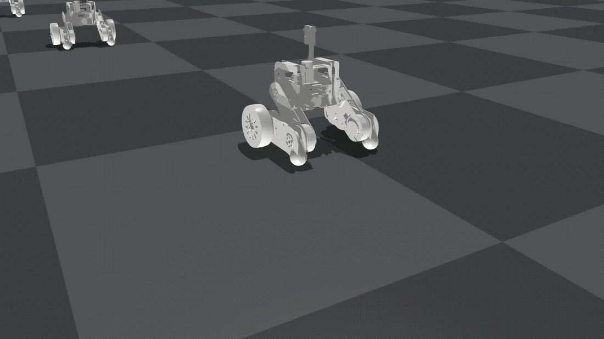 | 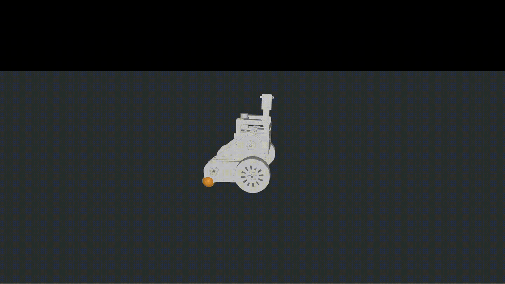 |
| Two-wheel walking | 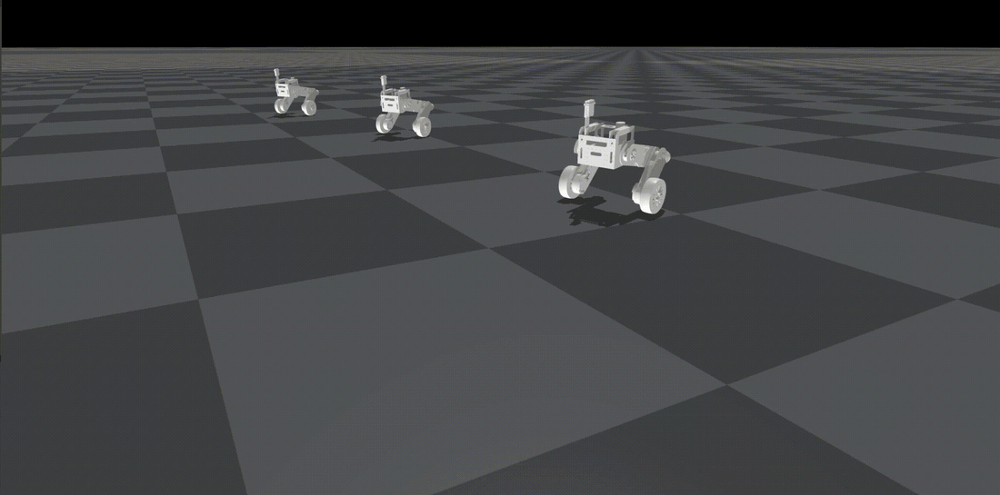 | 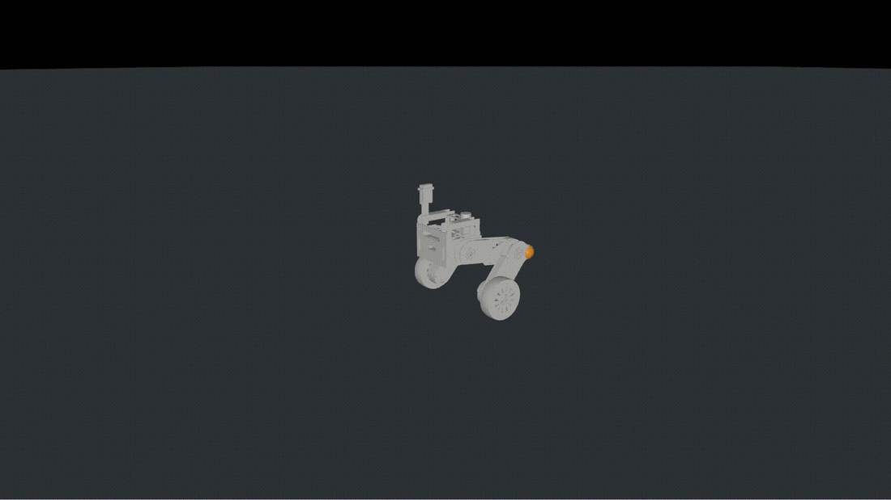 |
| Rough terrain |  | 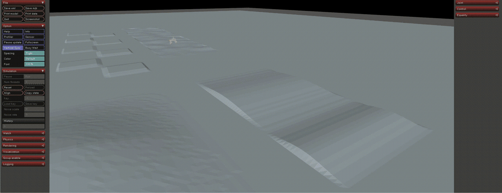 |
| Mode switching<br> | 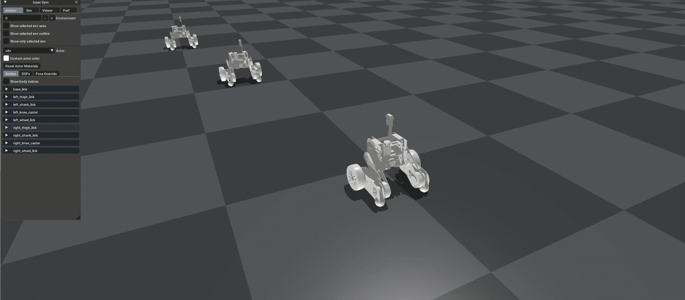 | 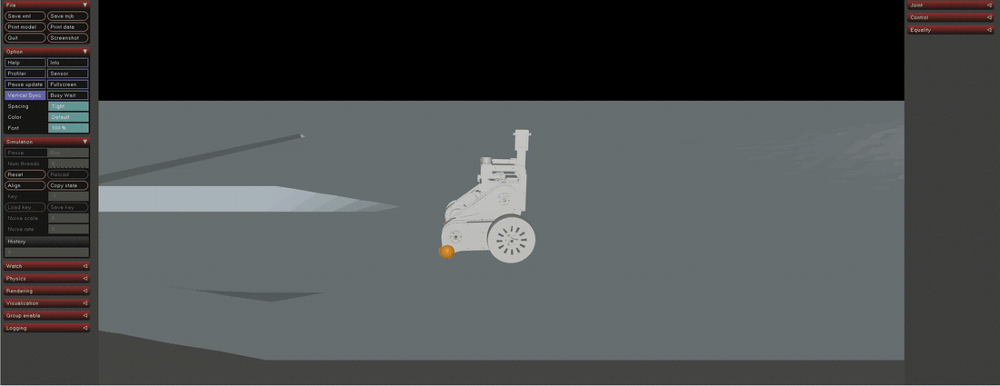 |
| Jump | 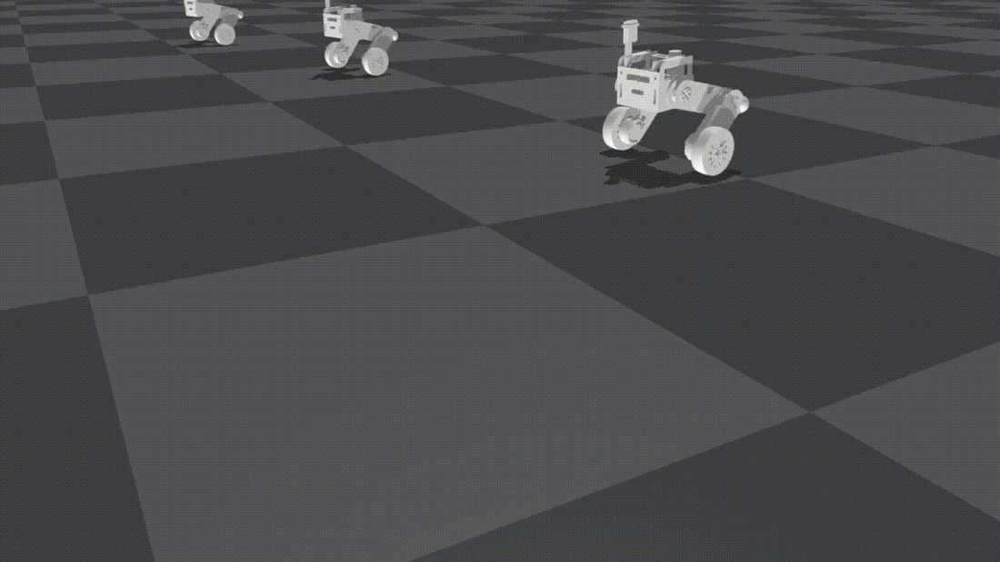 | 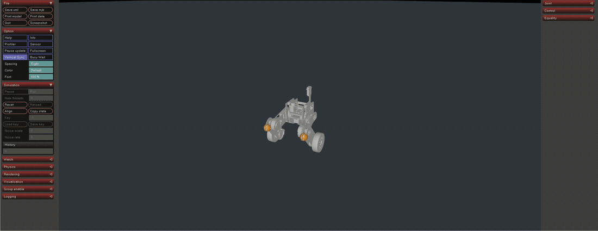 |

## Web console

`wbr_console` is a browser control surface over the simulation, started with `./run_bench.sh`
(→ `http://127.0.0.1:8770`). **Two engines**: Isaac Gym (training-native) and MuJoCo
(the `sim2sim_mujoco` deployment chain). Five tabs:

- **Simulation run** — start / stop, live command sliders (Vx / Yaw / Height / Roll / Jump);  
  in chain mode one-click stand-up / lie-down / load-jump / back-to-two-wheel / back-to-four-wheel /
  reset / slot-switch. The native Isaac Gym and MuJoCo windows are docked in the page.
- **Configure Isaac / Configure MJ** — selection and configuration of single-policy and
  multi-policy state machines, so different strategies can be observed side by side.
- **Telemetry plots** — command-following curves for motion and posture, the phase transitions of
  the jump state, and joint-torque responses; curves of the two engines can be compared.
- **Reference** — parameter glossary, shortcuts and storage paths.

<table>
<tr><th>Simulation run · Isaac Gym</th><th>Simulation run · MuJoCo</th></tr>
<tr><td>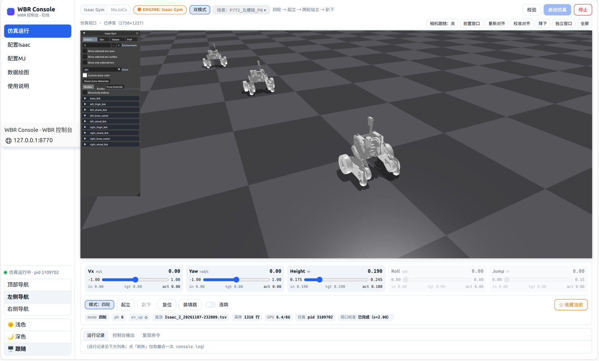</td><td>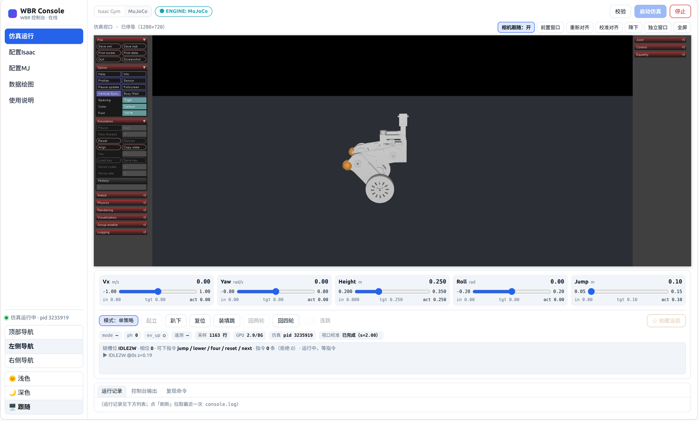</td></tr>
<tr><th>Configure Isaac</th><th>Configure MJ</th></tr>
<tr><td>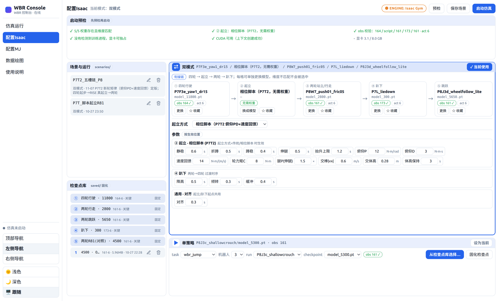</td><td>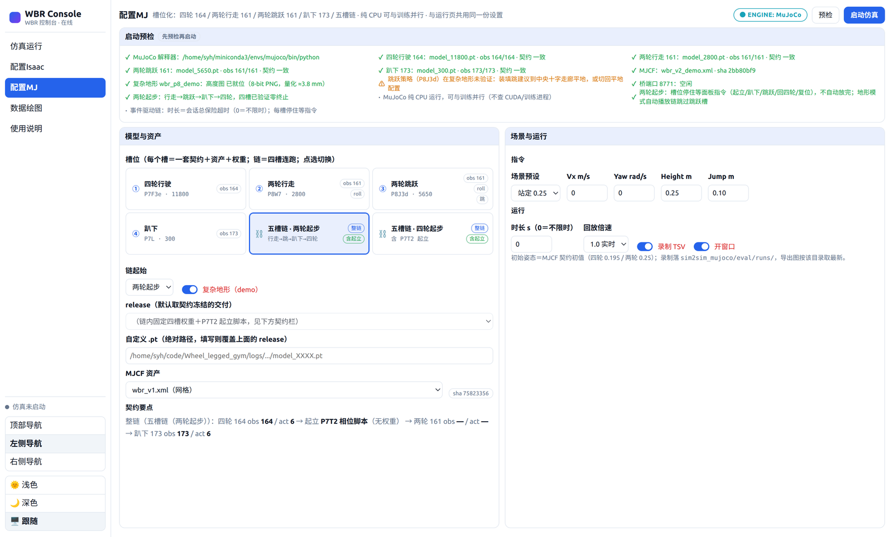</td></tr>
<tr><th>Telemetry plots</th><th>Reference</th></tr>
<tr><td>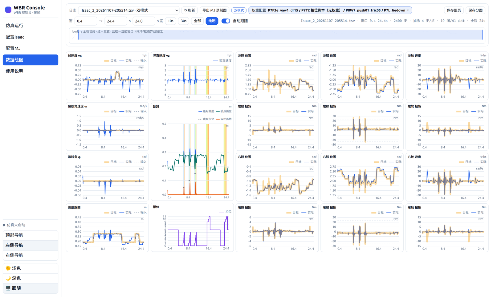</td><td>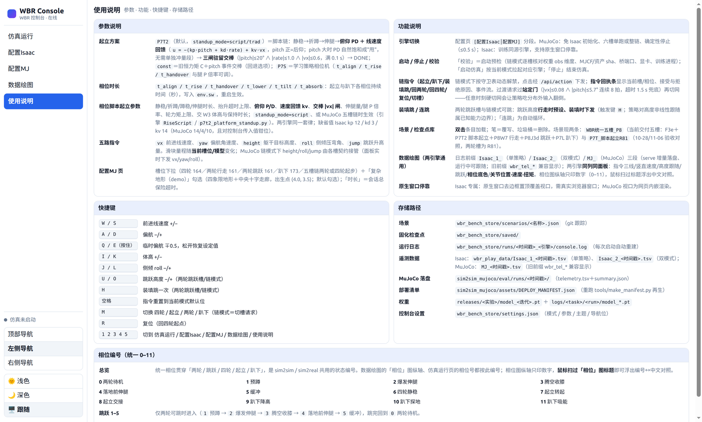</td></tr>
</table>

## Repository layout

```
legged_gym/
├── envs/
│   ├── base/          LeggedRobot base class, config defaults
│   └── wbr/           ★ this project
│       ├── flat/      wbr.py, wbr_flat_config.py — two-wheel walking + jumping
│       ├── flat4/     wbr_flat4.py, wbr_flat4_config.py — four-wheel driving
│       ├── switch/    stand-up / lie-down phase machine
│       ├── uni/       unified multi-mode env, FSM, observation builder
│       └── terrain/   offline height-map generators and release/ evaluation maps (npz)
├── scripts/           train / play / telemetry; the wbr_console web console (two engines);
│                      sim2sim_mujoco/ (MuJoCo deployment chain: contracts / assets / six-slot
│                      chain / acceptance scripts / deployment manifest)
└── utils/             task registry, helpers, terrain, logger
rsl_rl-1.0.2/          bundled PPO implementation
resources/robots/wbr/  URDFs and meshes
releases/              demo weights only (P7F3e four-wheel, P8W7 walking, P8J3d jump,
                       P6R81 jump reference, P7L lie-down); full training via train.py
```

## Requirements

| Item | Version / note |
| --- | --- |
| GPU | NVIDIA (CUDA-capable) |
| OS | Ubuntu 20.04 |
| Python | 3.8 — Isaac Gym Preview 3 ships binaries for 3.8 only |
| Simulation | **Isaac Gym Preview 3**, from the NVIDIA developer package |
| PyTorch | The one bundled with your Isaac Gym Preview 3 environment |
| PPO | `rsl_rl` **1.0.2, already vendored** in `rsl_rl-1.0.2/` — do not `pip install rsl-rl` |

## Installation

```bash
# 1. Isaac Gym (download the package from NVIDIA's developer site first)
cd isaacgym/python && pip install -e . && cd ../..

# 2. this repository
pip install -e .

# 3. plotting / terrain generation
pip install matplotlib numpy scipy
```

If Python cannot find its own shared library:

```
ImportError: libpython3.8.so.1.0: cannot open shared object file
```

export the library path of your environment before running anything:

```bash
export LD_LIBRARY_PATH=$CONDA_PREFIX/lib:$LD_LIBRARY_PATH
```

Check the install — this must print `8`:

```bash
python -c "
import isaacgym, torch
import legged_gym.envs
from legged_gym.utils import task_registry
print(len(task_registry.task_classes))
"
```

> Import `legged_gym.envs` before `legged_gym.utils`: the task registry is filled by the former,
> and `isaacgym` must be imported before `torch`.

## Quick start

```bash
# train (headless; writes to logs/<experiment_name>/<run_name>/)
python legged_gym/scripts/train.py --task wbr_flat --headless

# continue a run for 300 more iterations
python legged_gym/scripts/train.py --task wbr_terrain --resume --max_iterations 300

# MuJoCo deployment chain (no GPU init; the two-wheel-start four-slot chain runs 9.6 s with zero terminations)
python -m legged_gym.scripts.sim2sim_mujoco.deploy.uni_chain --start 2w

# interactive web console (two engines, five slots, P7T2 platform stand-up, plots) → http://127.0.0.1:8770
cd legged_gym/scripts/wbr_console && ./run_bench.sh
```

`play02.py` accepts the iteration suffix only, so copy the release's `model_*.pt` and `config.json`  
into your `logs/<task>/` directory and pass the folder name as `--load_run`.

Telemetry and plots: `play02.py` writes TSV segments to `legged_gym/scripts/wbr_play_data/`,  
`plot02.py` turns them into a self-contained HTML page.

## Acknowledgements

- [**legged_gym**](https://github.com/leggedrobotics/legged_gym) by Nikita Rudin, Robotic Systems
  Lab, ETH Zurich — the training framework this repository derives from.
- [**rsl_rl**](https://github.com/leggedrobotics/rsl_rl) v1.0.2 — the PPO implementation used here.
- [**NVIDIA Isaac Gym**](https://developer.nvidia.com/isaac-gym) — the physics simulation backend.
- [**fgmn/Wheel_legged_gym**](https://github.com/fgmn/Wheel_legged_gym) — the wheel-legged robot
  base this work extends.
- [**OpenCode**](https://opencode.ai) — AI assistance for development, refactoring
  and documentation; all code reviewed and owned by the author.

All redistributed code retains its original license; see [LICENSE](LICENSE), [NOTICE](NOTICE) and
`licenses/`.

## License

BSD 3-Clause — see [LICENSE](LICENSE). This is research code; use at your own risk.

---

**Author**: SYH ([@Yihuan01](https://github.com/Yihuan01))
