# WBR 轮腿双足机器人 · 强化学习控制

<p align="center"></p>

**WBR 是一台双模式轮腿双足机器人**：两个驱动轮 + 两侧各一条两连杆腿（髋 + 膝），外加被动万向轮。能够实现四种轮腿运动能力——两轮行走、跳跃、四轮行驶、模式切换。使用 PPO 强化学习算法训练，训练在 Isaac Gym 中完成，使用 MuJoCo 进行 Sim2Sim 验证。

> **本仓库为个人学习记录使用**：记录我个人的训练过程与产出的权重，尚且不是一个完善成熟的框架，也不提供支持。  
> [English](README.en.md) | 中文

## 概述

本项目搭建了一个**轮腿双足机器人**的强化学习控制器，基于膝关节从动轮的特殊构型，设计完成以下任务：

| 能力 | 任务 | 做什么 |
| --- | --- | --- |
| 两轮行走 | `wbr_flat` | 平地上两轮模式按速度 / 偏航指令控制运动，按滚转 / 高度指令控制姿态 |
| 两轮跳跃 | `wbr_jump` | 跳跃动作进行阶段拆分：预蹲 → 蹬地 → 空中收腿 → 落地缓冲；实现 5-10 cm 高度的跳跃动作 |
| 复杂地形 | `wbr_terrain` / `wbr_drop15` | 两轮模式时实现在非平面地形的自适应运动，能够应对左右高度不一致、起伏路面、跃下 15 cm 台阶等情况 |
| 四轮行驶 | `wbr_flat4` | 膝关节从动万向轮着地，实现四轮模式，提供相较于两轮更快速灵活的行驶与转向能力 |
| 模式切换 | `wbr_switch`、`wbr_uni` | 两轮和四轮模式相互切换；四轮模式切换到两轮模式采用传统控制脚本，反向采用网络控制，所有策略由相位机统一编排 |

训练侧摩擦、质量、执行器、传感、延迟、推扰、观测噪声等 DR 已开启并完成验证

## 功能演示

同一套策略权重在两个仿真引擎上的五种动作（Isaac Gym＝训练同源；MuJoCo＝`sim2sim_mujoco` 部署链）。

| | Isaac Gym | MuJoCo |
| --- | --- | --- |
| 平地四轮 | 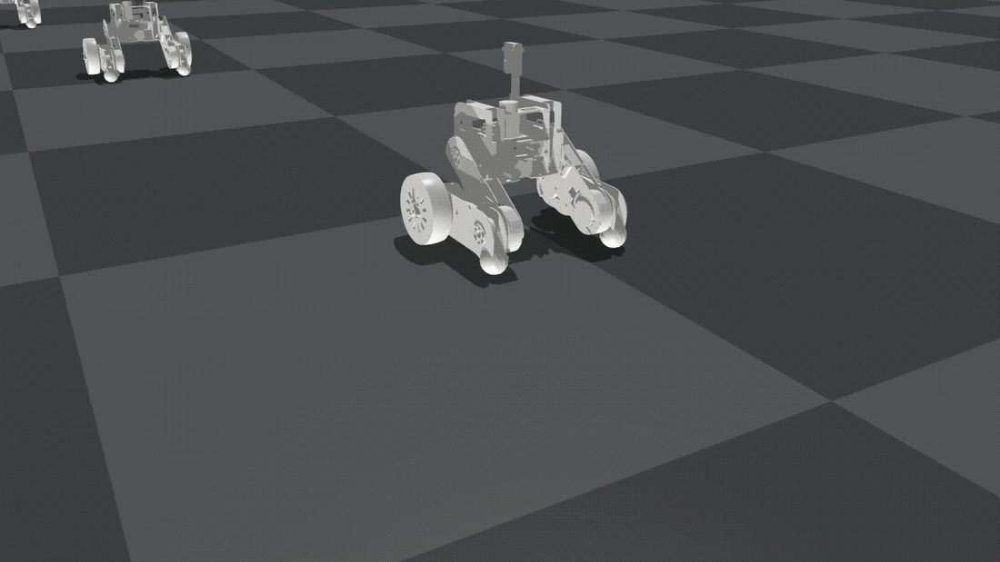 |  |
| 平地两轮 | 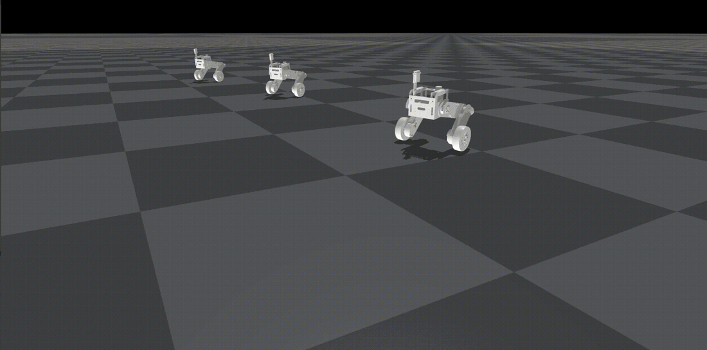 | 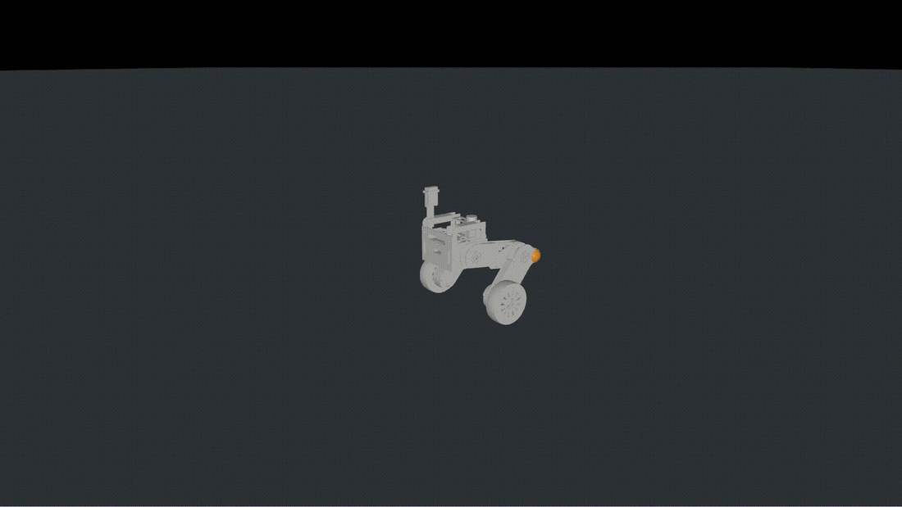 |
| 复杂地形 |  | 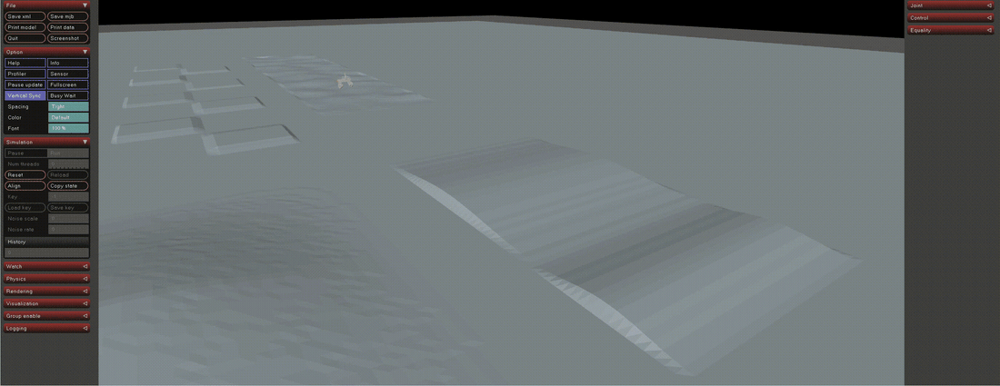 |
| 模式切换<br> | 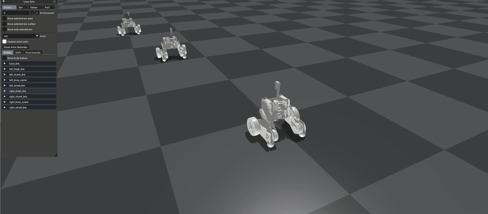 | 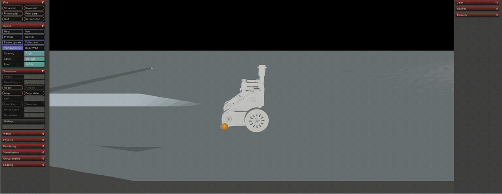 |
| 跳跃动作 | 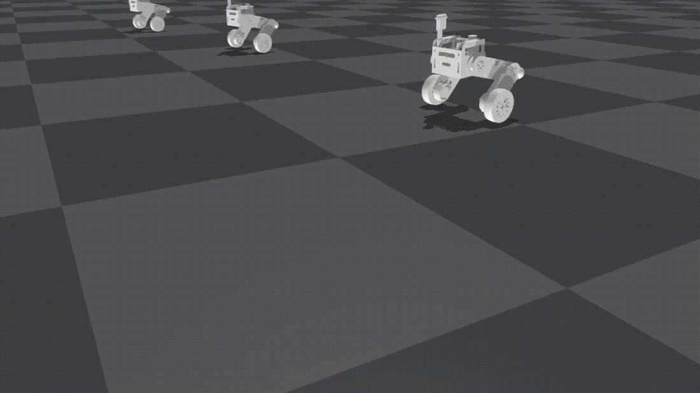 | 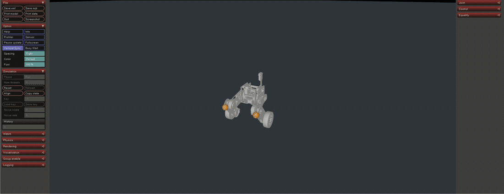 |

## 网页控制台

`wbr_console` 是仿真之上的浏览器控制台，用 `./run_bench.sh` 启动（→ `http://127.0.0.1:8770`）。
**双引擎**：Isaac Gym（训练同源）与 MuJoCo（`sim2sim_mujoco` 部署链）。
五个页签：

- **仿真运行** —— 启动/停止仿真，实时指令滑条（Vx / Yaw / Height / Roll / Jump），  
  链模式下一键起立 / 趴下 / 装填跳 / 回两轮 / 回四轮 / 复位 / 切槽。IsaacGym、MuJoCo 原生窗口停靠显示。
- **配置Isaac / 配置MJ** —— 实现单策略和多策略状态机选择与配置，以实现对不同的策略的对比观测。
- **数据绘图** —— 绘制运动与姿态的指令跟随曲线、跳跃状态的相位变化情况、各关节力矩响应情况；双引擎曲线对比。
- **使用说明** —— 参数词典、快捷键与存储路径。

<table>
<tr><th>仿真运行 · Isaac Gym</th><th>仿真运行 · MuJoCo</th></tr>
<tr><td>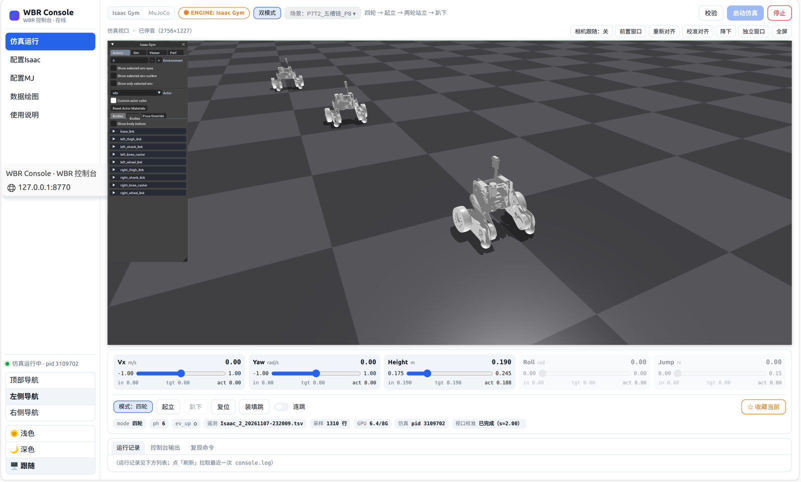</td><td>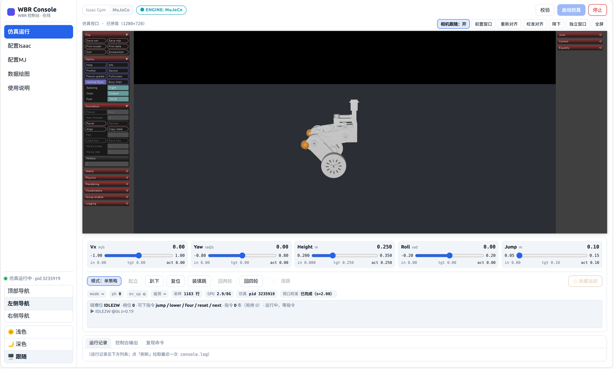</td></tr>
<tr><th>配置Isaac</th><th>配置MJ</th></tr>
<tr><td>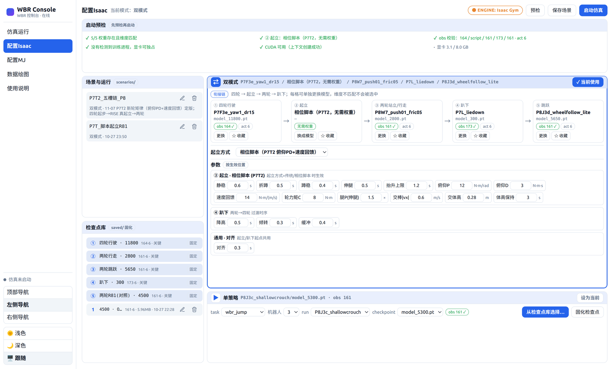</td><td>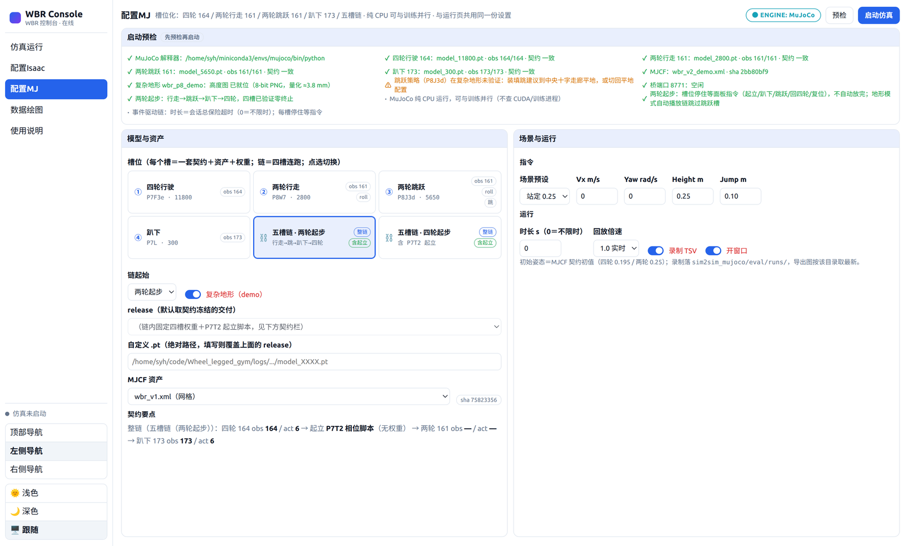</td></tr>
<tr><th>数据绘图</th><th>使用说明</th></tr>
<tr><td>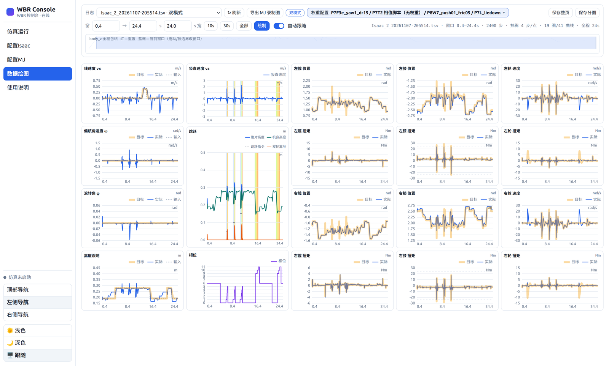</td><td>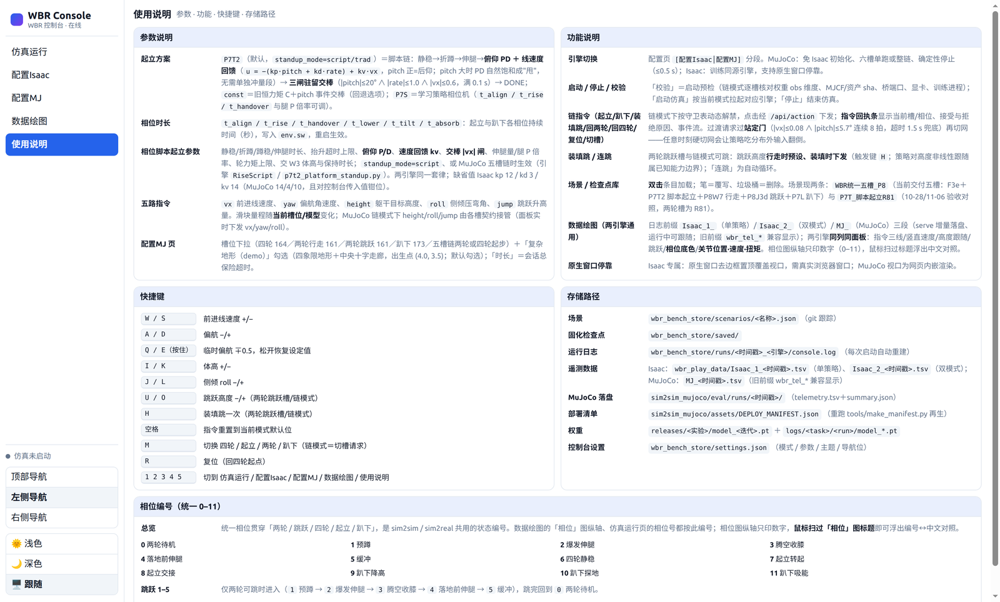</td></tr>
</table>

## 目录结构

```
legged_gym/
├── envs/
│   ├── base/          LeggedRobot 基类与配置默认值
│   └── wbr/           ★ 本项目
│       ├── flat/      wbr.py、wbr_flat_config.py —— 两轮行走 + 跳跃
│       ├── flat4/     wbr_flat4.py、wbr_flat4_config.py —— 四轮行驶
│       ├── switch/    起立 / 趴下的相位机
│       ├── uni/       统一多模式环境、状态机、观测拼装
│       └── terrain/   离线高度图生成器与 release/ 验收图（npz）
├── scripts/           训练 / 回放 / 遥测；wbr_console 网页控制台（双引擎）；
│                      sim2sim_mujoco/（MuJoCo 部署链：契约/资产/六槽链/验收脚本/部署清单）
└── utils/             任务注册表、工具函数、地形、日志
rsl_rl-1.0.2/          自带的 PPO 实现
resources/robots/wbr/  URDF 与网格
releases/              演示用最小权重集（P7F3e 四轮、P8W7 行走、P8J3d 跳跃、P6R81 跳跃对照、P7L 趴下）；完整训练用 train.py
```

## 环境

| 项 | 版本 / 说明 |
| --- | --- |
| 显卡 | NVIDIA，支持 CUDA |
| 系统 | Ubuntu 20.04 |
| Python | 3.8 —— Isaac Gym Preview 3 只提供 3.8 的二进制包 |
| 仿真 | **Isaac Gym Preview 3**，需从 NVIDIA 开发者包下载 |
| PyTorch | 用 Isaac Gym Preview 3 环境自带的版本 |
| PPO | `rsl_rl` **1.0.2，已随仓库自带**在 `rsl_rl-1.0.2/`，**不要** `pip install rsl-rl` |

## 安装

```bash
# 1. 安装 Isaac Gym（先从 NVIDIA 开发者网站下载压缩包）
cd isaacgym/python && pip install -e . && cd ../..

# 2. 安装本仓库
pip install -e .

# 3. 绘图与地形生成所需依赖
pip install matplotlib numpy scipy
```

如果 Python 找不到自己的动态库：

```
ImportError: libpython3.8.so.1.0: cannot open shared object file
```

运行前先导出环境的库路径：

```bash
export LD_LIBRARY_PATH=$CONDA_PREFIX/lib:$LD_LIBRARY_PATH
```

自检安装是否成功 —— 应输出 `8`：

```bash
python -c "
import isaacgym, torch
import legged_gym.envs
from legged_gym.utils import task_registry
print(len(task_registry.task_classes))
"
```

> 先导入 `legged_gym.envs` 再导入 `legged_gym.utils`：任务表由前者填充；
> 另外 `isaacgym` 必须先于 `torch` 导入。

## 快速开始

```bash
# 训练（无界面；输出写到 logs/<experiment_name>/<run_name>/）
python legged_gym/scripts/train.py --task wbr_flat --headless

# 续训 300 轮
python legged_gym/scripts/train.py --task wbr_terrain --resume --max_iterations 300

# MuJoCo 部署链（免 GPU 初始化；两轮起步的四槽整链 9.6 s 零终止）
python -m legged_gym.scripts.sim2sim_mujoco.deploy.uni_chain --start 2w

# 网页控制台（双引擎、五槽、P7T2 平台式起立、绘图页）→ http://127.0.0.1:8770
cd legged_gym/scripts/wbr_console && ./run_bench.sh
```

`play02.py` 的 `--load_run` 只接受迭代号后缀，所以要把发布包的 `model_*.pt` 与 `config.json`  
复制到自己的 `logs/<task>/` 目录，再把该目录名传给 `--load_run`。

遥测与绘图：`play02.py` 把 TSV 数据段写到 `legged_gym/scripts/wbr_play_data/`，  
`plot02.py` 再把它生成自包含 HTML 页面。

## 致谢

- [**legged_gym**](https://github.com/leggedrobotics/legged_gym)（ETH Zurich，Nikita Rudin）——
  本仓库所基于的训练框架。
- [**rsl_rl**](https://github.com/leggedrobotics/rsl_rl) v1.0.2 —— 本项目使用的 PPO 实现。
- [**NVIDIA Isaac Gym**](https://developer.nvidia.com/isaac-gym) —— 物理仿真后端。
- [**fgmn/Wheel_legged_gym**](https://github.com/fgmn/Wheel_legged_gym) —— 本工作扩展的轮腿机器人基础。
- [**OpenCode**](https://opencode.ai) —— 辅助开发、重构与文档撰写；代码经本人审核并负责。

所有再分发的代码均保留原始许可证；见 [LICENSE](LICENSE)、[NOTICE](NOTICE) 与 `licenses/`。

## 许可证

BSD 3-Clause —— 见 [LICENSE](LICENSE)。这是研究代码，使用风险自担。

---

**作者**：SYH ([@Yihuan01](https://github.com/Yihuan01))
